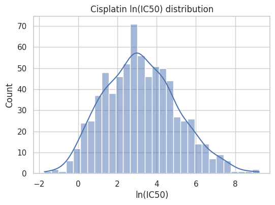
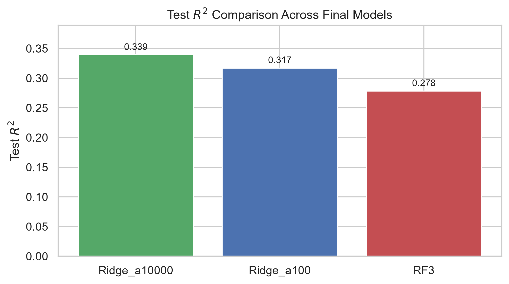
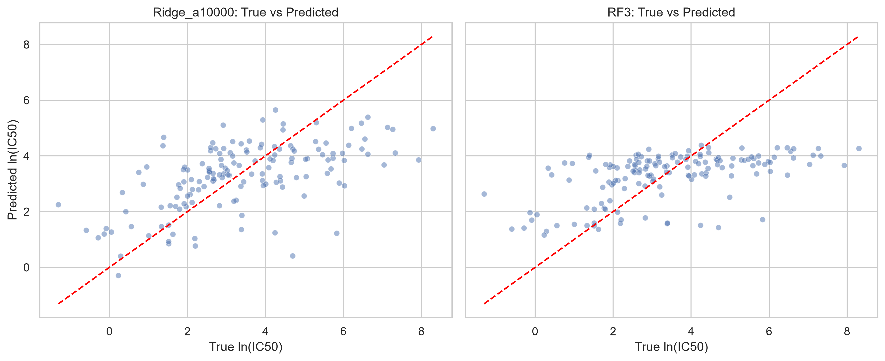
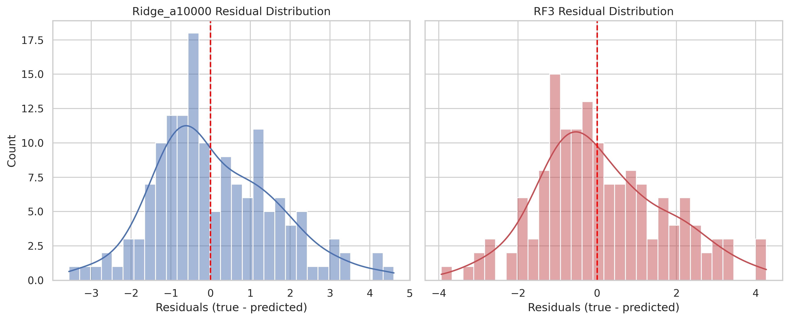
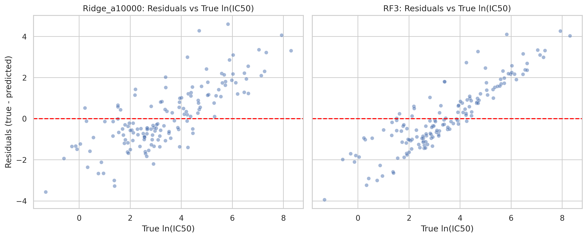
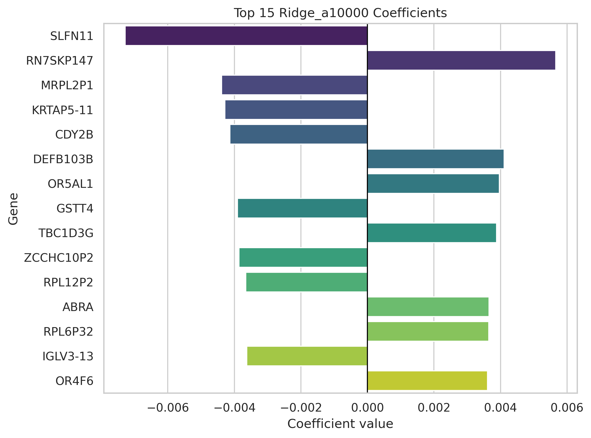
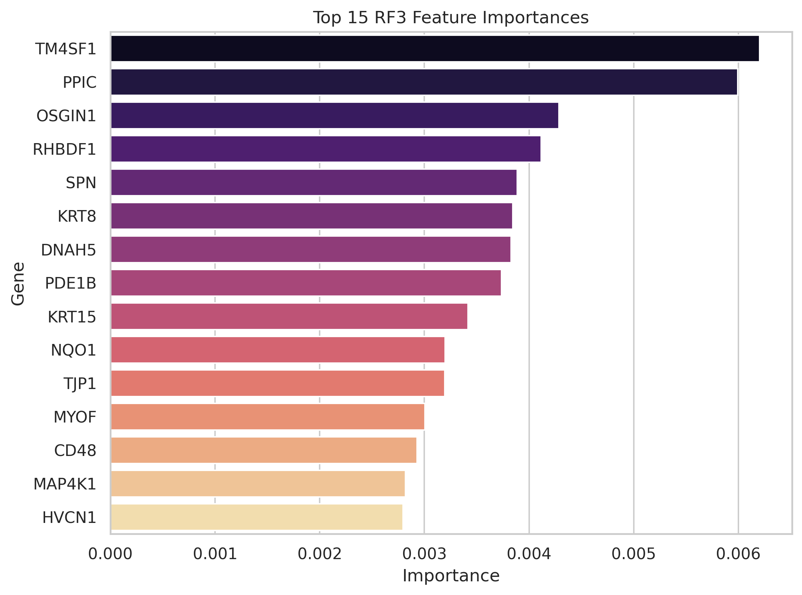
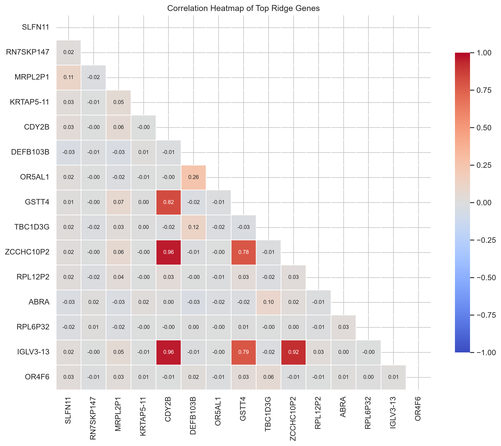
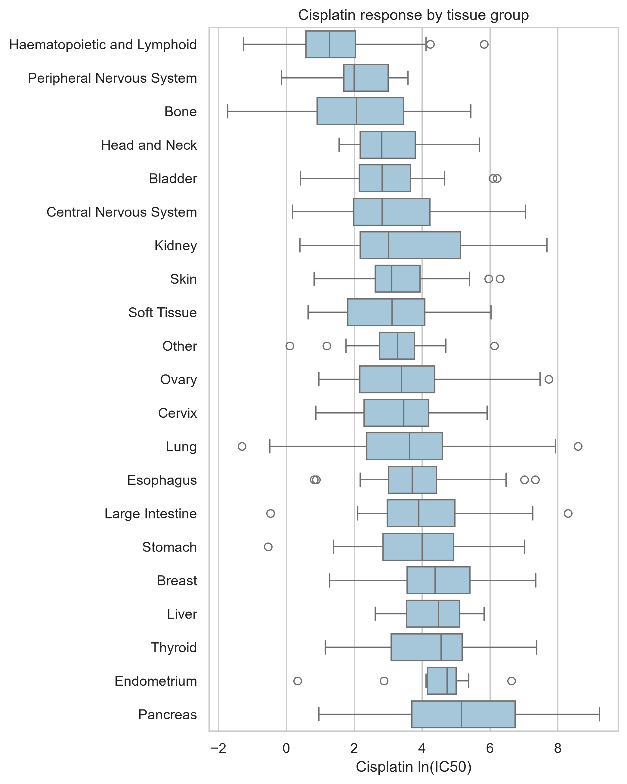
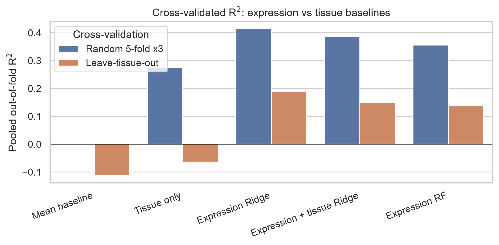

# Predicting Cisplatin Response from Gene Expression Using GDSC2

## Overview

This project evaluates whether baseline RNA-seq gene-expression profiles can predict cisplatin response across cancer cell lines in the Genomics of Drug Sensitivity in Cancer 2 (GDSC2) dataset. Cisplatin response was modeled as the supplied continuous `LN_IC50` value using both Ridge regression and Random Forest regression.

The final analysis used 743 cell lines and 36,438 gene-expression predictors. In the initial 80/20 split, the best-performing model was strongly regularized Ridge regression, which achieved a held-out test-set $R^2$ of 0.339.

Because cisplatin response differs by tissue of origin, a follow-up analysis added a tissue-only baseline plus repeated and leave-tissue-out cross-validation. In repeated 5-fold cross-validation, Ridge regression on expression reached a pooled out-of-fold $R^2$ of 0.414, compared with 0.274 for a model that knew only each cell line’s tissue. When entire tissues were held out, expression Ridge retained a pooled $R^2$ of 0.190, compared with -0.113 for a mean-only baseline.

## Research Question

Can baseline RNA-seq gene-expression profiles predict the supplied cisplatin `LN_IC50` response measure in held-out GDSC2 cancer cell lines?

## Background

Due to alterations in cancer genomes, different cancer cells can vary greatly in their response to anticancer drugs. This means that, in many cases, these alterations can be used as effective molecular biomarkers for response to drugs. Understanding these genomic markers and the resulting variation in response to different anticancer drugs can help create more informed hypotheses about treatment response and even potentially identify which patients might benefit most from a certain treatment. The Genomics of Drug Sensitivity in Cancer (GDSC) database is a large public resource for information on drug sensitivity in cancer cells and molecular markers of drug response. This database can help facilitate the discovery of new therapeutic biomarkers for different anticancer drugs. [1]

Cisplatin is a widely used chemotherapy agent. It has been shown to be effective against various types of cancers such as bladder, lung, ovarian, and testicular cancers. It seems to work due to its ability to damage DNA and cause apoptosis in cancer cells by crosslinking with purine bases. [2] However, like many anticancer drugs, the development of resistance remains a major challenge in the use of cisplatin. Using a database such as the GDSC database could help predict biomarkers that might affect how a patient responds to treatment with cisplatin.

## Objective

This project investigates the research question above by comparing regularized linear regression (Ridge) with Random Forest regression. The analysis emphasizes out-of-sample performance, overfitting control, residual diagnostics, and feature-ranking analysis. Drug response is represented by the dataset's supplied log-transformed IC50 measure, which was used directly as the value predicted by the tested regression models. It is important to note that results of this project are only intended as exploratory predictive associations, not clinical recommendations or evidence of causal mechanisms.

## Data

This project uses GDSC2 cancer cell-line data obtained through the [Cell Model Passports download portal](https://cellmodelpassports.sanger.ac.uk/downloads). Two data sources were integrated:

| Data source | Information used | Role in analysis |
|---|---|---|
| Drug-response data | Drug name, Sanger cell-model ID, and `LN_IC50` | Regression target |
| RNA-seq expression data | Sanger cell-model ID, gene symbol, and RSEM TPM expression value | Predictor variables |
| Cell model annotations (`models.csv`) | Sanger cell-model ID and tissue of origin | Tissue baseline and grouped cross-validation (Notebook 6) |

The drug-response dataset was filtered to cisplatin. RNA-seq records were filtered to the corresponding cell lines and reshaped from long format into a wide cell-line-by-gene matrix, where rows represented cell lines and columns represented genes. Drug-response and expression data were then matched using the Sanger cell-model ID.

The final modeling dataset contained **743 cell lines** and **36,438 baseline gene-expression predictors**. The outcome variable was the dataset-provided cisplatin `LN_IC50` value, which was used directly as a continuous regression target; no additional log transformation was applied. Cell-line identifiers and drug-name columns were excluded from model training.

### Cisplatin response distribution

The cisplatin response values were unimodal and approximately bell-shaped, with most observations concentrated around intermediate `LN_IC50` values and fewer observations at the low and high extremes. Therefore, the dataset covers a broad response range, although the response values are not evenly represented across that range.



**Figure 1.** Distribution of the supplied cisplatin `LN_IC50` values in the 743-cell-line modeling dataset.

## Methods

Data were split into 80% training and 20% held-out test sets using `random_state=42`, producing 594 training cell lines and 149 test cell lines. Missing expression values were mean-imputed using training data only, then the learned imputation values were applied to the test set.

The predictor matrix contained many more gene-expression features than observations. This high-dimensional setting creates a substantial risk of overfitting, which motivated the use of regularized regression and held-out test-set evaluation.

### Models

Two model families were compared:

| Model | Preprocessing | Purpose |
|---|---|---|
| Ridge regression | Mean imputation and standardization | Regularized linear prediction using an L2 penalty |
| Random Forest regression | Mean imputation; no standardization | Nonlinear tree-based ensemble prediction |

Two Ridge models were evaluated using different regularization strengths. The final Ridge regularization value was selected using five-fold cross-validation on the training set. The selected model used $\alpha$ = 10,000.

The final Random Forest configuration used 300 trees, `max_depth=7`, `max_features=200`, `min_samples_leaf=5`, and `random_state=42`.

### Evaluation

Models were evaluated on the held-out test set using:

- $R^2$, which compares the model with predicting the mean response.
- Root mean squared error (RMSE), which gives greater weight to larger prediction errors.
- Mean absolute error (MAE), which measures the average magnitude of the prediction error.

Predicted-vs-observed and residual plots were also examined to assess model behavior beyond aggregate metrics.

### Tissue baseline and cross-validation

The single 80/20 split cannot show how much of the predictive signal comes from the tissue of origin, or how stables the scores are. `06_tissue_baseline_and_cv.ipynb` therefore re-evaluated the models with tissue labels and cross-validation.

- **Tissue labels:** Tissue of origin came from the Cell Model Passports model annotation file (`models.csv`). Tissues with fewer than 10 cell lines were pooled into an “Other” group.
- **Cross-validation schemes:**
  - Repeated 5-fold cross-validation with 3 repeats (15 splits).
  - Leave-tissue-out cross-validation using grouped folds, in which all cell lines from a tissue group are held out together, so the model is tested on tissues it wasn’t trained on.
- **Models compared:**
  - A mean-only baseline
  - A tissue-only model (one-hot tissue labels with Ridge)
  - Expression Ridge
  - An expression-plus-tissue model that first predicts each tissue’s mean response then fits Ridge on gene expression to the remaining residual
  - A Random Forest using the RF3 settings which were chosen in the earlier single-split analysis
- **No tuning on held-out data:** Imputation, scaling, and the Ridge penalty (selected with `RidgeCV` from 15 values between 0.01 and 100,000) were all fit within each training fold.
- **Metric:** The headline metric is pooled out-of-fold $R^2$ (predictions for all held-out cell lines are collected and scored once against the overall mean). Pooling is used because, in leave-tissue-out folds that contain only one or two tissues, a per-fold $R^2$ is scored against that fold’s own mean and varies widely. Per-fold means and standard deviations are also saved in `data/metadata/cv_results.csv`.


## Results

### Test-set performance

| Model | Train $R^2$ | Test $R^2$ | Test RMSE | Test MAE |
|---|---:|---:|---:|---:|
| Ridge, $\alpha$ = 100 | 1.000 | 0.317 | 1.556 | 1.232 |
| Ridge, $\alpha$ = 10,000 | 0.932 | 0.339 | 1.530 | 1.223 |
| Random Forest 3 | 0.763 | 0.279 | 1.599 | 1.267 |

The strongly regularized Ridge model achieved the best held-out performance among the tested models. Although the less strongly regularized Ridge model fit the training set almost perfectly, its lower test performance indicates substantial overfitting. The selected Ridge model accepted a lower training fit in exchange for improved performance on unseen cell lines.



**Figure 2.** Held-out test-set $R^2$ values for the evaluated models. Higher values indicate better out-of-sample predictive performance.

### Prediction and residual diagnostics



**Figure 3.** Predicted versus observed cisplatin `LN_IC50` values in the held-out test set. The diagonal reference line represents perfect prediction.

The spread of points around the diagonal in the ridge test plot (left) indicates that the model captures some variation in cisplatin response but has meaningful prediction error for individual cell lines. This pattern is consistent with moderate out-of-sample performance, rather than near-perfect performance.



**Figure 4.** Distribution of Ridge and Random Forest 3 test-set residuals, defined as observed `LN_IC50` minus predicted `LN_IC50`.



**Figure 5.** Ridge and Random Forest 3 test-set residuals plotted against observed cisplatin `LN_IC50`. The horizontal reference line represents zero prediction error.

### Feature-ranking analysis

Ridge coefficients and Random Forest feature importances were examined to identify genes most strongly associated with model predictions. These rankings differed across model types, which is expected because Ridge and Random Forest quantify feature relevance differently.

Ridge coefficients represent standardized linear associations between expression and predicted `LN_IC50`, conditional on the other features in the model. Random Forest feature importance measures how much a feature contributed to prediction across tree splits. Neither ranking should be interpreted as evidence that a gene causes cisplatin sensitivity or resistance.



**Figure 6.** Top 15 gene-expression features ranked by absolute coefficient magnitude in the Ridge regression model (𝛼 = 10,000). Bars show signed coefficients; negative values indicate that higher expression contributes to lower predicted cisplatin LN_IC50, while positive values indicate a contribution to higher predicted LN_IC50, holding other predictors constant. SLFN11 has the largest absolute coefficient among the displayed features. These coefficients describe model-specific predictive associations, not causal effects.



**Figure 7.** Top 15 gene-expression features ranked by importance in the Random Forest model (RF3). Importance scores represent the normalized reduction in the splitting criterion attributed to each feature across the forest, with TM4SF1 and PPIC receiving the highest scores among the displayed features. Unlike Ridge coefficients, these scores do not indicate whether higher expression increases or decreases predicted cisplatin LN_IC50. The rankings describe model-specific feature relevance and should not be interpreted as validated biomarkers.



**Figure 8.** Pairwise expression correlations among the 15 highest-ranked Ridge features. Red indicates positive correlation, blue indicates negative correlation, and values near zero indicate weak linear correlation; only the lower triangle is displayed to avoid duplicating gene pairs. Most displayed pairs show weak correlations, but CDY2B, GSTT4, ZCCHC10P2, and IGLV3-13 form a strongly positively correlated group, with pairwise correlations ranging from approximately 0.78 to 0.96. These correlations are between expression features, not between genes and cisplatin response.

Strong correlations among some highly ranked features suggest overlapping expression information. Consequently, individual Ridge coefficients should be interpreted cautiously rather than as independent measures of biological relevance.

### Tissue baseline and cross-validated performance

Cisplatin response differed across tissue groups: median `LN_IC50` ranged from roughly 1 for haematopoietic and lymphoid cell lines to roughly 5 for pancreas, although the spread within each tissue was large and most distributions overlapped.



**Figure 9.** Distribution of cisplatin LN_IC50 by tissue group, ordered by median. Tissues with fewer than 10 cell lines are pooled into “Other”. The number of cell lines per tissue is not shown.

Pooled out-of-fold $R^2$ (per-fold sandard deviation in parentheses):

| Model | Random 5-fold, 3 Repeats | Leave-tissue-out |
|---|---:|---:|
| Mean Baseline | -0.002 (0.006) | -0.113 (0.646) |
| Tissue Only | 0.274 (0.051) | -0.064 (0.637) |
| Expression Ridge | 0.414 (0.064) | 0.190 (0.538) |
| Expression + Tissue (Two Stage) | 0.388 (0.080) | 0.150 (0.360) |
| Expression Random Forest | 0.356 (0.037) | 0.138 (0.465) |



**Figure 10.** Pooled out-of-fold $R^2$ for each model under random and leave-tissue-out cross-validation. Bars below zero indicate performance worse than predicting the overall mean. The random-split mean-baseline bar is near zero (-0.002) and therefore barely visible.

- Tissue alone explained about 27% of the variance in random cross-validation.
- Adding expression to tissue raied pooled $R^2$ from 0.274 to 0.388, so expression carried predictive information beyond tissue means. Expression Ridge alone scored 0.414; the 0.026 difference from the two-stage model is smaller than the fold-to-fold variation and should not be interpreted.
- Ridge outperformed the Random Forest in both schemes, which is consistent with the single-split result.
- When whole tissues were held out, the tissue-only model could not improve on the mean baseline, while expression models retained positive pooled $R^2$ (0.138 to 0.190). Some predictive signal therefore transfers to unseen tissues, although performance was lower than in random cross-validation.

## Discussion

The strongly regularized Ridge model generalized best to the held-out test set among the models evaluated. This suggests that, for this dataset, predictive signal may be represented more effectively by many small and regularized linear gene-expression effects than by the nonlinear patterns captured by the tested Random Forest configurations.

The improvement associated with stronger Ridge regularization is particularly relevant because the dataset contains many more gene-expression predictors than cell lines. In this setting, an unconstrained or weakly constrained model can fit training-specific noise, producing highly optimistic training performance that does not necessarily transfer to new observations.

The cross-validated analysis shows that tissue of origin accounts for a substantial part of the predictable signal, and that expression adds information beyond it. Performance dropped when whole tissues were held out, which suggests that part of the random-split performance relies on tissue-specific patterns. Positive performance on unseen tissues does not by itself show that the signal is independent of tissue lineage, because expression profiles of related tissues resemble one another. The feature rankings above come from the single-split models and were not re-examined after accounting for tissue, so some highly ranked genes may actually mark tissue lineage and not drug-specific mechanisms.

The results still indicate only moderate predictive performance. Baseline gene expression alone does not provide a sufficiently precise cisplatin-response predictor for clinical use in this analysis. The models and feature rankings should therefore be treated as exploratory tools for hypothesis generation rather than validated biomarkers or causal evidence.

## Limitations

- The modeling dataset included 743 cell lines but 36,438 gene-expression predictors, creating a high-dimensional problem with a substantial risk of overfitting.
- The initial models (Notebooks 3 to 5) were evaluated on one 80/20 split, and some settings were compared using test-set scores. So those test-set numbers are exploratory. Repeated cross-validation in Notebook 6 gives more stable estimates, but its folds overlap and are not independent, so small differences between models should not be treated as significant.
- The Random Forest used fixed hyperparameters from the single-split analysis and was not tuned inside cross-validation.
- Leave-tissue-out cross-validation uses few folds, and some tissues have few cell lines, so per-fold scores vary widely.
- Only Ridge regression and a limited set of Random Forest configurations were evaluated.
- The analysis used baseline RNA-seq expression alone and did not incorporate mutation, copy-number, methylation, or other molecular features. Tissue of origin was only used in Notebook 6, not as a feature in the Notebook 3 to 5 models.
- Cancer cell lines do not fully reproduce patient tumors, including tumor microenvironment effects, pharmacokinetics, and clinical treatment conditions.
- Feature rankings represent model-specific predictive associations, not causal mechanisms or clinically validated biomarkers, and were not re-evaluated after accounting for tissue.
- The findings were not validated in an independent external dataset.

## Repository Structure

```text
.
gdsc-drug-response-project/
├── data/
│   ├── README.md
│   ├── raw/
│   │   └── .gitkeep
│   ├── processed/
│   │   └── .gitkeep
│   └── metadata/
│       ├── cisplatin_cohort_summary.csv
│       └── cv_results.csv
├── figures/
│   ├── cisplatin-response-distribution.jpg
│   ├── model_test_r2_comparison.png
│   ├── predicted_vs_true_ridge_rf.png
│   └── ...
├── notebooks/
│   ├── 01_data_loading_and_qc.ipynb
│   ├── 02_eda.ipynb
│   ├── 03_baseline_models.ipynb
│   ├── 04_model_comparison_and_interpretation.ipynb
│   ├── 05_final_figures.ipynb
│   └── 06_tissue_baseline_and_cv.ipynb
├── .gitignore
├── requirements.txt
└── README.md
```

The notebook order is:

| Notebook | Purpose |
|---|---|
| `01_data_loading_and_qc.ipynb` | Loads, filters, reshapes, and merges drug-response and expression data |
| `02_eda.ipynb` | Examines data structure, missingness, and cisplatin-response distribution |
| `03_baseline_models.ipynb` | Trains baseline Ridge and Random Forest models |
| `04_model_comparison_and_interpretation.ipynb` | Compares models and examines coefficients or feature importances |
| `05_final_figures.ipynb` | Produces README-ready figures |
| `06_tissue_baseline_and_cv.ipynb` | Adds tissue-of-origin baselines as well as repeated and leave-tissue-out cross-validation |

## How to Run

### 1. Clone the repository

```bash
git clone https://github.com/AarzuM39/gdsc-drug-response-project.git
cd gdsc-drug-response-project
```

### 2. Download the data

Large raw and processed datasets are not included in this repository. Download the required GDSC2 drug-response and RNA-seq expression files from the [Cell Model Passports download portal](https://cellmodelpassports.sanger.ac.uk/downloads).

To reproduce the analysis, download the following GDSC2 and RNA-seq resources from Cell Model Passports:

| Required data | Source | Purpose in this project |
|---|---|---|
| GDSC2 drug-response data | Cell Model Passports GDSC2 download | Provides cisplatin response values, including `LN_IC50` |
| Processed RNA-seq data | Cell Model Passports RNA-seq processed-data download | Provides baseline gene-expression values (`RSEM TPM`) |
| Cell-model annotations, if needed | Cell Model Passports model annotation download | Provides identifiers and optional metadata for cell lines |

Place the downloaded files in the expected local structure:

```text
data/
├── raw/
│   ├── drug.csv
│   ├── models.csv
│   └── expr.csv
└── processed/
```
The `data/` directory is excluded from version control because the source files are too large for standard GitHub storage. Run `notebooks/01_data_loading_and_qc.ipynb` to filter the public source data to cisplatin-treated cell lines, reshape RNA-seq data into a cell-line-by-gene matrix, and generate project-specific processed files.

> **Note:** File names may vary across Cell Model Passports releases. If the downloaded files use different names, update the file paths in the data-loading notebook or rename the files locally to match the expected paths.


See [`data/README.md`](data/README.md) for data requirements, expected file names, and additional instructions. The first notebook generates project-specific processed files inside `data/processed/`.

### 3. Create a virtual environment

Create and activate a virtual environment from the repository root.

**macOS/Linux**

```bash
python3 -m venv .venv
source .venv/bin/activate
```

**Windows PowerShell**

```powershell
py -m venv .venv
.\.venv\Scripts\Activate.ps1
```

If PowerShell prevents script execution, run the following command for the current terminal session and activate the environment again:

```powershell
Set-ExecutionPolicy -Scope Process -ExecutionPolicy Bypass
.\.venv\Scripts\Activate.ps1
```

### 4. Install dependencies and register the Jupyter kernel

```bash
python -m pip install --upgrade pip
pip install -r requirements.txt
pip install jupyterlab ipykernel
```

### 5. Launch JupyterLab

From the repository root:

```bash
jupyter lab
```

Open the `notebooks/` directory. For each notebook, select the kernel named:

```text
Python (gdsc-drug-response)
```

### 6. Run notebooks in order

1. `notebooks/01_data_loading_and_qc.ipynb`  
   Loads, filters, reshapes, and merges the GDSC2 drug-response and RNA-seq data.

2. `notebooks/02_eda.ipynb`  
   Performs exploratory data analysis and creates data-quality and response-distribution outputs.

3. `notebooks/03_baseline_models.ipynb`  
   Trains the baseline Ridge and Random Forest models.

4. `notebooks/04_model_comparison_and_interpretation.ipynb`  
   Compares final models, evaluates held-out performance, and examines coefficients and feature importances.

5. `notebooks/05_final_figures.ipynb`  
   Generates publication-ready figures saved to `figures/`.

6. `notebooks/06_tissue_baseline_and_cv.ipynb`  
   Adds tissue-of-origin baselines as well as repeated and leave-tissue-out cross-validation. Saves `data/metadata/cv_results.csv` and the two cross-validation figures.

For reproducibility, use **Kernel → Restart Kernel and Run All Cells** for each notebook before proceeding to the next one.

## References

[1] Yang, W., Soares, J., Greninger, P., et al. (2013). Genomics of Drug Sensitivity in Cancer (GDSC): a resource for therapeutic biomarker discovery in cancer cells. *Nucleic Acids Research*, 41(Database issue), D955–D961. [DOI](https://doi.org/10.1093/nar/gks1111)

[2] Dasari, S., & Tchounwou, P. B. (2014). Cisplatin in cancer therapy: molecular mechanisms of action. *European Journal of Pharmacology*, 740, 364–378. [DOI](https://doi.org/10.1016/j.ejphar.2014.07.025)
